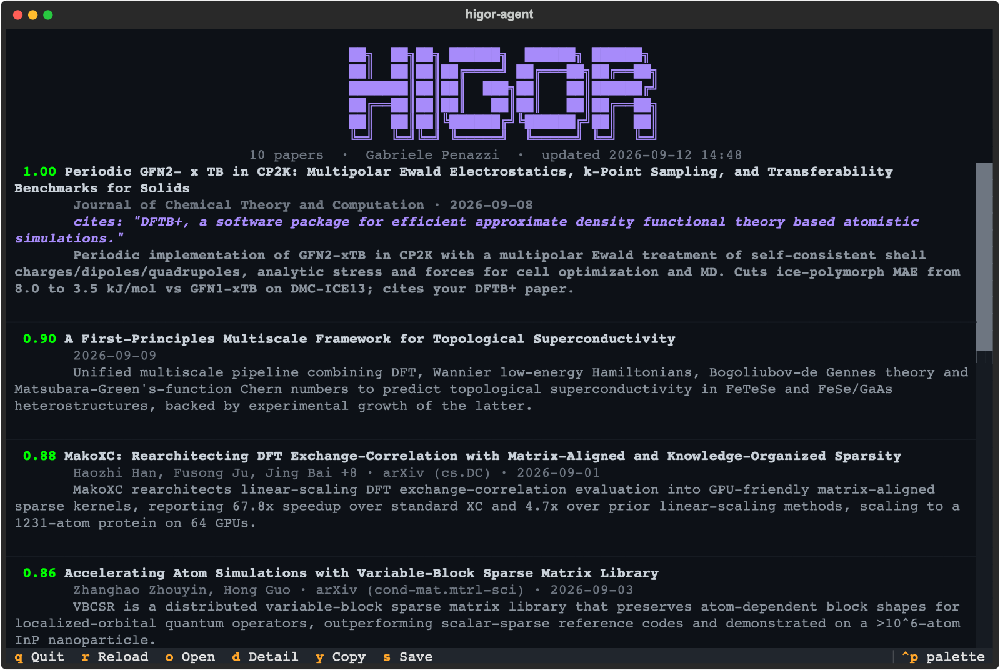
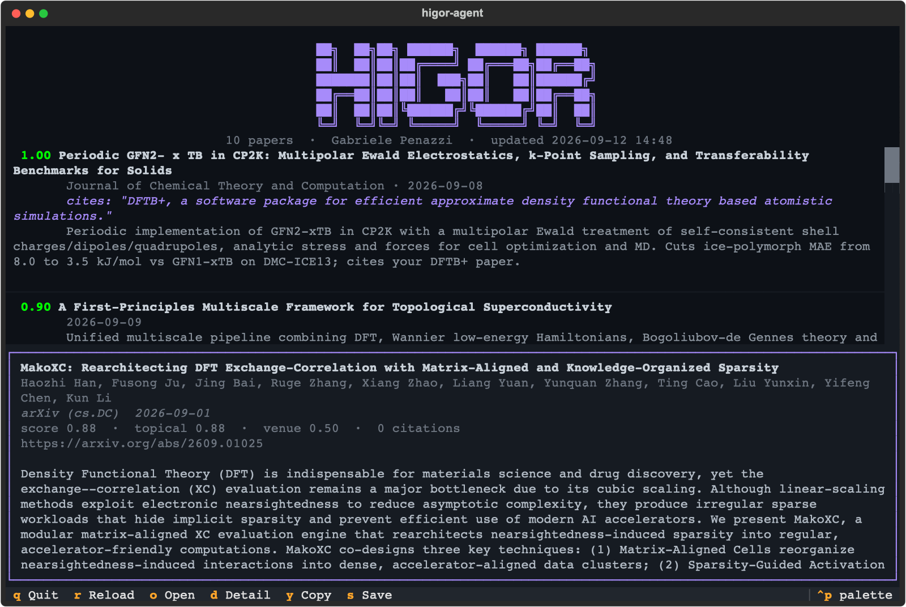

# higor-agent

Literature screening for **any** agent harness.

The agent loop lives in whatever harness you already use: Claude Code, Copilot CLI,
Codex, Cursor. What ships here is a set of shell commands, a ranking core, one instruction
file and a browser.

```
┌─ your LLM chat ───────────────────────┐
│  Claude Code · Copilot CLI · ...      │   the only place a model runs
│                                       │
│  /higor-digest ──▶ agent ◀── skills   │
└─────────────────────┬─────────────────┘
                      │ shell commands, plain-text replies
                      ▼
          ┌─ higor-agent ─────────┐   HTTP   Semantic Scholar
          │ sweep · rank · blend  │ ───────▶ arXiv
          └───────────┬───────────┘          Crossref
                      │ reads and writes
                      ▼
          ┌─ my-research/.higor ─────────────────────┐
          │ profile.toml          journal_ranks.json │
          │ session_cache.json    last_session.json ─┼──▶ higor-agent view ─┐
          │ reading_log.jsonl ◀──────────────────────┼──────────────────────┘
          └──────────────────────────────────────────┘    or any reader of your own:
                                                          a web page, a script, email
```

The package contains **no model and no provider SDK**. Your harness is the only thing that
talks to an LLM, which is what makes the same workflow portable.



## Why it is built this way

higor-agent is kept as simple as possible on purpose. It works with the LLM chat you
already use, through skills, so it is not tied to any particular model, API key or
subscription. Switch from Claude to Copilot, or to whatever comes next, and your profile,
venue ratings and reading history come with you.

The agent reaches the engine through skills as well: each tool is a plain shell command
that the skill teaches it to run. There is no MCP server to register, keep running or
configure per harness.

The price is that the viewer is decoupled from the chat. You talk to the agent in one
window and read papers in another, and the two meet only through a file on disk (see
[Where the digest is saved](#where-the-digest-is-saved)). The upside is that the viewer is
optional: anything that can read that file can show your digest.

## What it does

1. **Collect.** One sweep per digest: your topic phrases on Semantic Scholar (exact-phrase,
   restricted to your fields of study and a server-side date window), the same phrases on
   arXiv within your categories, every recent paper from the journals you follow, papers
   that cite your own work, and Semantic Scholar recommendations seeded by your papers.
   A few hundred candidates, de-duplicated across sources.
2. **Read.** The agent reads every title, fetches abstracts for the promising ones (missing
   abstracts are back-filled from Semantic Scholar's TL;DR, then Crossref) and scores
   topical relevance.
3. **Blend.** `show` multiplies that score by a venue term plus a citation bonus. The
   agent rates each new journal once and the rating is cached in `journal_ranks.json`;
   preprints are neutral. `impact_weight` in the profile controls how much this moves things.
4. **Browse.** `show` writes the ranked list to disk and the viewer redraws. Keyboard
   actions there are the only source of the reading log, which feeds back into later runs.

## Getting started

Everything happens in one folder of yours, the **workspace** (`~/my-research` below; any
folder works). Your profile, venue ratings, reading log and digest all live in its
`.higor/` directory, so nothing is written anywhere else, and separate folders can follow
separate research interests.

**1. Install the tool** (once):

```bash
cd ~/Work/higor-agent
uv sync
```

**2. Turn your folder into a workspace:**

```bash
uv run higor-agent install claude-code --dest ~/my-research
```

This creates `~/my-research/.higor/` and two skills under `~/my-research/.claude/skills/`:
`higor` (the tools and how to use them) and `higor-digest` (the weekly digest as a slash
command). The agent runs the tools from its shell, so there is no server to register.
Claude Code and GitHub Copilot CLI both read `.claude/skills/`, so the same target serves
both. Re-run the command whenever you pull a new version.

From here on, run every command from the workspace. They use
`uv run --project ~/Work/higor-agent`, which runs the tool without leaving the folder you
are in. An alias saves typing:

```bash
alias higor='uv run --quiet --project ~/Work/higor-agent higor-agent'
```

**3. Build your profile** (once per workspace):

```bash
cd ~/my-research
higor profile            # interactive; writes .higor/profile.toml
```

**4. Start your agent there and ask for the digest:**

```bash
claude          # or: copilot
```

```
/higor-digest           # your profile's lookback window
/higor-digest 30        # the last 30 days
```

After that, ask in plain words: "more like #12", "search for GPU tight binding and add the
good ones", "why is #7 ranked so high?".

- **Copilot CLI** loads a folder's skills only once you trust it: accept the trust prompt
  the first time you run `copilot` there.
- **Claude Code** may ask before the first `higor-agent` command. Allow it for the project
  and it will not ask again.

**5. Watch the list** in a second terminal, from the same folder:

```bash
cd ~/my-research
higor view
```

The viewer follows the file, so the list updates as the agent publishes it.

### Other harnesses

For Codex, Cursor or anything else that reads `AGENTS.md`:

```bash
uv run higor-agent install agents-md --dest ~/my-research   # .higor/ and AGENTS.higor.md
```

Paste its contents into that folder's `AGENTS.md`. There is no slash command there; start
a digest with the message `higor-agent digest-prompt` prints.

### The viewer

Press `d` on any paper for the abstract and the scoring signals behind its rank.



#### Keys

| Key | Action |
| --- | --- |
| `o` | Open in the browser, logged as read |
| `d` | Toggle the abstract pane, logged as read |
| `y` | Copy title, authors and URL |
| `s` | Mark as saved in the reading log |
| `r` | Reload the snapshot now |
| `q` | Quit |

## Where the digest is saved

Every `show` writes the current list to one file in the workspace, overwritten each time:

```
~/my-research/.higor/last_session.json
```

It is plain JSON, so you can serve the digest however you like: a static web page, a
notebook, a script that emails it, a feed reader. The terminal viewer is just one reader of
this file. An excerpt (each paper also carries `id`, `doi` and `arxiv_id`):

```json
{
  "fetched_at": "2026-10-17T08:12:45+00:00",
  "note": "Week of 12 October",
  "papers": [
    {
      "handle": "#12",
      "title": "...",
      "authors": ["..."],
      "journal": "Physical Review B",
      "published": "2026-10-14T00:00:00Z",
      "url": "https://doi.org/...",
      "abstract": "...",
      "summary": "The agent's one or two sentences.",
      "relevance_score": 0.81,
      "topical_relevance": 0.75,
      "venue_prestige": 0.7,
      "citation_count": 3,
      "cites_author_paper": ""
    }
  ]
}
```

Papers are sorted by `relevance_score`, the final blended score. Only the latest list is
kept; copy the file after each digest if you want an archive. What you open and save in the
viewer goes to `.higor/reading_log.jsonl`, one JSON object per line.

## The tools

Each tool is a `higor-agent` subcommand that prints plain text for the agent to read.

| Command | What it does |
| --- | --- |
| `context` | Profile, reading history, today, and what is currently shown. Run first. |
| `candidates` | Sweep every configured source, paged with `--page` |
| `search` | One phrase on Semantic Scholar and arXiv, optionally venue-restricted |
| `related` | Recommendations for, and citations of, given handles |
| `papers` | Full records and abstracts for up to 40 handles |
| `venues` | Journals with no cached prestige rating |
| `rate-venues` | Cache the agent's venue judgements (JSON on stdin) |
| `show` | Blend, publish to the browser, write the snapshot (JSON on stdin) |
| `update-profile` | Edit the saved profile |

Every paper the agent touches gets a handle like `#12`. Commands accept handles or raw ids;
the browser and the snapshot show them. Handles live in `session_cache.json` between
commands and start over after twelve idle hours, so each day's conversation begins at `#1`.
A lock makes concurrent commands wait their turn, which also keeps them inside the
Semantic Scholar rate limit.

## Who judges what

Every judgement comes from the host agent. Topical relevance arrives through `show`, venue
standing through `venues` and `rate-venues`. That is why the package
needs no model of its own: it validates, caches and blends, and never decides.

A venue is rated once and the rating is reused by every later session, so the cache is worth
keeping an eye on. It is plain JSON, sorted by name, and you can correct any entry by hand.

## Requirements

- Python 3.11+ and [uv](https://docs.astral.sh/uv/)
- A harness that can run shell commands
- Optional: a free [Semantic Scholar API key](https://www.semanticscholar.org/product/api)
  in `S2_API_KEY` lifts the unauthenticated rate limit

## State

Everything lives in the workspace's `.higor/`. Commands find it the way git finds `.git`:
in the current folder or the nearest parent, so they also work from a subfolder. Outside a
workspace they stop with an error rather than write somewhere else. Set `HIGOR_DIR` to
point at a state directory directly.

```
my-research/.higor/
  profile.toml         your profile, including [sources] and impact_weight
  journal_ranks.json   cached venue prestige, hand-editable
  reading_log.jsonl    append-only interaction log
  last_session.json    the published list; the viewer follows this
  session_cache.json   papers and handles between commands
  session.lock         keeps two commands from running at once
  higor-agent.log      warnings and errors
```

## Scheduling a weekly digest

The harness supplies the loop, so a digest is a headless run of your harness against these
tools, started with the same slash command. With Claude Code:

```bash
cd ~/my-research && claude -p "/higor-digest"
```

With Copilot CLI (`--allow-all-tools` is required in non-interactive mode):

```bash
cd ~/my-research && copilot --allow-all-tools -p "/higor-digest"
```

## Development

```bash
uv run pytest -v
uv run higor-agent install reference   # regenerate integrations/ after editing agent/*.md
uv run python scripts/screenshot.py    # regenerate the README images from your own list
```

`scripts/screenshot.py` draws whatever is in your state directory, so pass `--state` a copy
if you would rather not publish your own papers. It never writes to the reading log.
